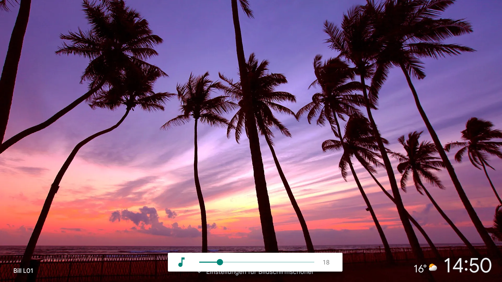
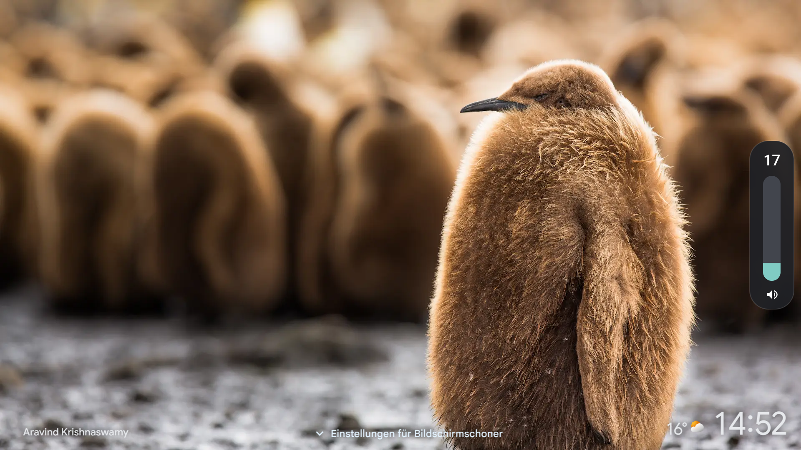
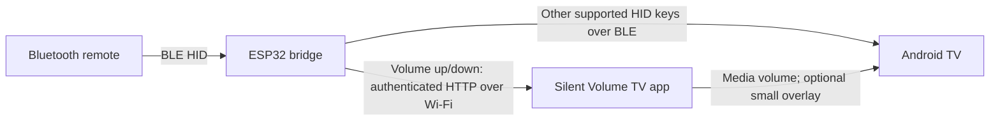
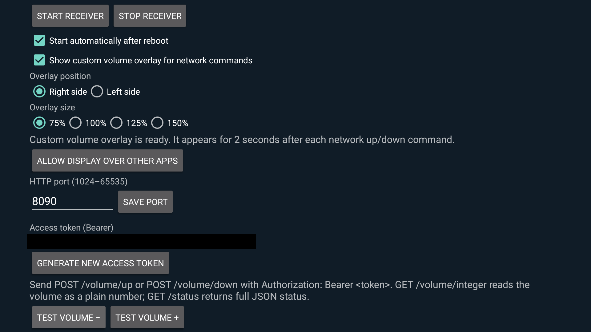

# Silent Volume TV

Keep subtitles visible when changing the volume on an Android TV.

My PEAQ Android TV has a volume bar that covers subtitles, and I couldn't find
a setting to move or resize it. So, with help from ChatGPT/Codex, I put together
this workaround: an ESP32 Bluetooth bridge and a small Android app.

The ESP32 catches the remote's volume buttons and sends them to the app over
Wi-Fi. The app changes the volume and can show a smaller bar on either side of
the screen. I can keep using my remote without the big volume bar getting in
the way.

## Before and after

| Before: PEAQ system volume bar | After: ESP32 bridge + Android app |
| --- | --- |
|  |  |

Here are both volume bars on my TV. The screensaver changed between shots, but
you can see how much space each one takes up. Click either image for the full size.

## How it works

The bridge forwards supported remote keys to the TV over Bluetooth. Volume up
and down go to the Android app over the local network instead, so Android
doesn't receive the usual volume key events.

A closer look at the custom overlay.

## App settings on the TV

I use the overlay on the **Right side** at **75%** size. I've covered my access
token in the screenshot. See the
[app guide](android-app/README.md) for setup and the available options.

## What you need

- An Android 11 TV with adjustable Android media volume and permission to sideload apps.
- A compatible Bluetooth LE HID remote. Mine is an **RC860G**.
- An original ESP32 development board with USB power. I use a WROOM board;
  the board settings I built with are in the firmware guide.
- A 2.4 GHz Wi-Fi network through which the ESP32 can reach the TV. The TV can use
  Wi-Fi or Ethernet.

I've tested navigation and volume on my PEAQ TV with the RC860G remote. It also
reconnects after resetting or unplugging the ESP32 and after rebooting the TV,
without having to pair everything again.

I couldn't find the exact PEAQ model in Android's settings, so it's listed here
as a PEAQ Android 11 TV.

I haven't tried other TVs, remotes or ESP32 variants yet. If you get it working
on another setup, I'd love to hear which hardware and Android version you used.

## Set up

1. [Build and install the Android app](android-app/README.md#build), open it on the
   TV, and press **Start receiver**. Note its LAN address, port and access token.
2. In `esp32-firmware/BLEHIDBridge/`, copy `BridgeConfig.h.example` to
   `BridgeConfig.h`. Set your Wi-Fi credentials, TV address/token, and remote
   selection. This local header is ignored by Git.
3. Follow the [firmware build guide](esp32-firmware/BUILD.md), including the pinned
   NimBLE persistence patch, then the [pairing guide](esp32-firmware/README.md#pairing).
4. Test navigation and volume while playing content with subtitles. Optionally
   enable the custom overlay and its display-over-other-apps permission in the app.

No Android root or Accessibility service is used. The remote must connect through
the bridge for its volume keys to be intercepted. Direct Bluetooth connections,
infrared signals, and HDMI-CEC volume controls can still trigger a device's own bar.

## Repository

| Path | Contents |
| --- | --- |
| [android-app/](android-app/) | Android app, Gradle wrapper, build helper, JVM tests |
| [esp32-firmware/](esp32-firmware/) | BLE bridge sketch, configuration template, tests and tools |
| [docs/architecture.md](docs/architecture.md) | Data flow, HTTP API and implementation limits |
| [docs/reconnect-notes.md](docs/reconnect-notes.md) | What fixed the pairing problem and how I tested it |
| [docs/development.md](docs/development.md) | Local checks and CI |
| [THIRD_PARTY_NOTICES.md](THIRD_PARTY_NOTICES.md) | Dependency licenses and notices |

## Limits

Only Consumer Control **volume up and down** are intercepted. Mute and other
supported keys follow the normal HID forwarding path. Voice/microphone transport,
IR-only remotes, Boot Protocol and PIN-entry pairing are outside this implementation.
Large vendor reports can be blocked by the negotiated BLE MTU.

The app changes Android's media stream. Fixed-volume outputs and independently
drawn TV/receiver displays need device-specific handling. This is a sideloaded
Android 11 project; its target SDK is not configured for Google Play submission.

The local API uses a bearer token over **unencrypted HTTP**. Use a trusted LAN;
do not expose the receiver to the Internet. Firmware built with your local header
contains its Wi-Fi password and API token. Keep those binaries private.

## License

The project's own code and documentation are available under the
[MIT License](LICENSE). Third-party files and dependencies keep their own
licenses; see [THIRD_PARTY_NOTICES.md](THIRD_PARTY_NOTICES.md). The screensaver
photos visible in the screenshots aren't covered by the software license.
